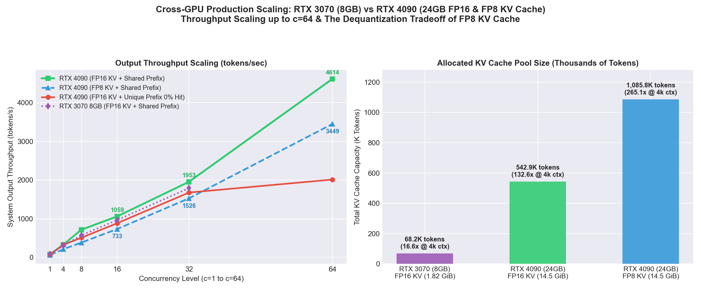
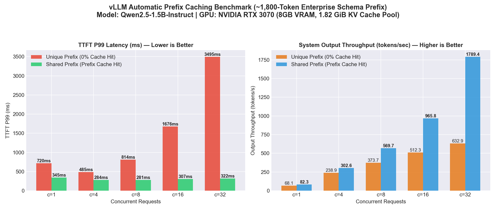
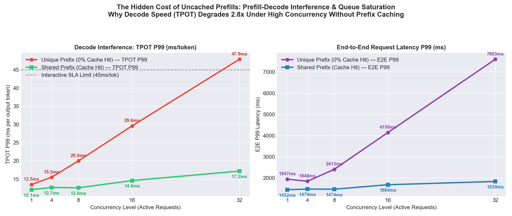

# Production vLLM Stress-Testing & Cost Engineering (RTX 3070 8GB vs RTX 4090 24GB FP16/FP8)

An empirical benchmark and systems analysis of **vLLM Automatic Prefix Caching (APC)**, **Ada Lovelace FP8 KV Cache (`--kv-cache-dtype fp8`)**, and **Prefill-Decode Interference** under concurrent enterprise RAG / Text-to-SQL workloads (~1,800-token shared system schema).

---

## 1. Executive Summary (3 Counter-Intuitive Production Findings)

1. **Missing the Prefix Cache Doesn't Just Hurt TTFT—It Degrades Decode Speed (TPOT) by up to 2.8x**:
   - On `RTX 3070 (8GB)` at `c=32`, 0% prefix cache hit caused **TTFT P99 to explode 10.8x (`321.9 ms` → `3,495.0 ms`)** and **TPOT P99 to degrade 2.8x (`17.2 ms` → `47.9 ms/tok`, breaching a 45ms SLA)** due to **Prefill-Decode Interference** (heavy uncached Prefill GEMMs stealing GPU cycles from active Decode streams).
   - On `RTX 4090 (24GB)` at `c=64`, Prefix Caching cut **TTFT P99 by 11.8x (`1,778.0 ms` → `150.7 ms`)**, cut **TPOT P99 by 2.2x (`28.9 ms` → `13.1 ms`)**, and boosted output throughput by **2.29x (`2,011.1 tok/s` → `4,613.9 tok/s`)**.
2. **The FP8 KV Cache Tradeoff (`--kv-cache-dtype fp8`) — 2.0x Capacity vs ~25% Dequantization Overhead**:
   - Enabling `--kv-cache-dtype fp8` on `RTX 4090` doubled the allocated KV cache pool from **`542,912 tokens` (`132.55x` @ 4k ctx)** to **`1,085,824 tokens` (`265.09x` @ 4k ctx)** in the exact same `14.5 GiB` VRAM envelope.
   - **However**, when the workload was *not* VRAM-capacity-bound (`c=64`), `FP16 KV Cache` achieved **33.8% higher throughput (`4,613.9 tok/s` vs `3,449.1 tok/s`)** and lower TPOT (`13.1 ms` vs `19.4 ms`) than `FP8 KV Cache` because of on-the-fly FP8 scale/dequantization overhead in the attention kernel.
   - **FDE Rule of Thumb**: Do not blindly enable `--kv-cache-dtype fp8` everywhere. Enable it only when `kv_cache_usage_pct > 85%`, when serving long-context workloads (`32k+`), or when fitting larger models (`14B/32B`) where avoiding sequence preemption outweighs the ~25% kernel overhead.
3. **Unit Economics (`$/1M Output Tokens` at Saturation)**:
   - At `c=64` with Prefix Caching (`4,613.94 output tok/s` = `16.61M output tokens/hour`), a single cloud `RTX 4090` (`~$0.39/hr` on RunPod Spot / `~$0.59/hr` On-Demand) delivers **`$0.023 – $0.035 per 1M output tokens`** while maintaining a `150.7 ms` TTFT P99 and `13.1 ms` TPOT P99.







---

## 2. Hardware & KV Cache Allocation Telemetry

| GPU Hardware | Util Flag | Allocated KV Cache Pool | Total KV Tokens | Max Concurrency (@ 4,096 ctx) | Peak Output Throughput |
|---|---:|---:|---:|---:|---:|
| **NVIDIA RTX 3070 (8GB)** | `0.65` | `1.82 GiB` (FP16) | `68,176 tokens` | `16.64x` | `1,789.4 tok/s` (`@ c=32`) |
| **NVIDIA RTX 4090 (24GB)** | `0.80` | `14.50 GiB` (FP16) | `542,912 tokens` | `132.55x` | **`4,613.9 tok/s`** (`@ c=64`) |
| **NVIDIA RTX 4090 (24GB)** | `0.80` | `14.50 GiB` (**FP8**) | **`1,085,824 tokens`** | **`265.09x`** | `3,449.1 tok/s` (`@ c=64`) |

---

## 3. Full Experimental Dataset

### 3.1 NVIDIA RTX 4090 (24GB) — `unique_prefix` (0% Cache Hit Baseline)

| Concurrency | Mode | Throughput (tok/s) | TTFT P50 (ms) | TTFT P99 (ms) | TPOT P50 (ms) | TPOT P99 (ms) | E2E P99 (ms) |
|---:|---:|---:|---:|---:|---:|---:|---:|
| 1 | unique_prefix | **75.63** | 34.4 | **411.1** | 12.7 | 15.1 | 1538.0 |
| 4 | unique_prefix | **324.44** | 69.8 | **110.4** | 11.8 | 12.3 | 1224.2 |
| 8 | unique_prefix | **507.80** | 120.1 | **216.0** | 14.6 | 16.6 | 1644.0 |
| 16 | unique_prefix | **883.05** | 163.4 | **435.0** | 16.7 | 18.6 | 2122.9 |
| 32 | unique_prefix | **1675.50** | 178.5 | **854.2** | 17.0 | 17.8 | 2488.8 |
| 64 | unique_prefix | **2011.13** | 199.9 | **1778.0** | 26.5 | 28.9 | 4377.0 |

### 3.2 NVIDIA RTX 4090 (24GB) — `shared_prefix` (FP16 KV Cache + Prefix Cache Hit)

| Concurrency | Mode | Throughput (tok/s) | TTFT P50 (ms) | TTFT P99 (ms) | TPOT P50 (ms) | TPOT P99 (ms) | E2E P99 (ms) |
|---:|---:|---:|---:|---:|---:|---:|---:|
| 1 | shared_prefix | **78.10** | 26.4 | **41.2** | 12.0 | 15.0 | 1466.3 |
| 4 | shared_prefix | **331.18** | 54.6 | **61.5** | 11.1 | 14.2 | 1397.2 |
| 8 | shared_prefix | **714.62** | 43.2 | **45.6** | 10.9 | 11.0 | 1082.0 |
| 16 | shared_prefix | **1058.97** | 54.6 | **73.5** | 14.6 | 14.8 | 1461.5 |
| 32 | shared_prefix | **1952.92** | 65.4 | **76.5** | 15.9 | 16.0 | 1592.1 |
| 64 | shared_prefix | **4613.94** | 85.4 | **150.7** | 12.9 | 13.1 | 1380.1 |

### 3.3 NVIDIA RTX 4090 (24GB) — `shared_prefix` with `--kv-cache-dtype fp8` (1.08M KV Tokens)

| Concurrency | Mode | Throughput (tok/s) | TTFT P50 (ms) | TTFT P99 (ms) | TPOT P50 (ms) | TPOT P99 (ms) | E2E P99 (ms) |
|---:|---:|---:|---:|---:|---:|---:|---:|
| 1 | shared_prefix (FP8) | **59.80** | 39.5 | **791.1** | 15.5 | 19.4 | 2338.5 |
| 4 | shared_prefix (FP8) | **212.82** | 49.5 | **418.9** | 15.8 | 19.6 | 1920.1 |
| 8 | shared_prefix (FP8) | **381.69** | 64.0 | **70.3** | 18.0 | 18.9 | 1772.8 |
| 16 | shared_prefix (FP8) | **733.03** | 183.1 | **705.4** | 15.7 | 20.9 | 2201.5 |
| 32 | shared_prefix (FP8) | **1525.89** | 73.6 | **85.4** | 20.3 | 21.7 | 2056.3 |
| 64 | shared_prefix (FP8) | **3449.07** | 114.4 | **135.1** | 16.6 | 19.4 | 1729.8 |

### 3.4 NVIDIA RTX 3070 (8GB) — `unique_prefix` vs `shared_prefix` (`c=1..32`)

| Concurrency | Mode | Throughput (tok/s) | TTFT P50 (ms) | TTFT P99 (ms) | TPOT P50 (ms) | TPOT P99 (ms) | E2E P99 (ms) |
|---:|---:|---:|---:|---:|---:|---:|---:|
| 1 | unique_prefix | **68.09** | 133.0 | **719.9** | 12.8 | 13.5 | 1947.2 |
| 16 | unique_prefix | **512.27** | 642.3 | **1676.2** | 24.8 | 29.6 | 4149.7 |
| 32 | unique_prefix | **632.90** | 702.0 | **3495.0** | 43.2 | 47.9 | 7602.8 |
| 1 | shared_prefix | **82.33** | 31.7 | **344.6** | 11.7 | 12.1 | 1451.8 |
| 16 | shared_prefix | **965.80** | 88.0 | **307.4** | 13.9 | 14.6 | 1684.4 |
| 32 | shared_prefix | **1789.43** | 141.8 | **321.9** | 16.0 | 17.2 | 1838.7 |

---

## 4. Production Troubleshooting Notes

1. **Why 90% of Production Prompts Accidentally Break Prefix Caching**:
   vLLM hashes KV cache blocks sequentially in 16-token blocks. Injecting a dynamic timestamp (`Current Time: ...`), `request_id`, or `session_nonce` on Line 1 of the system prompt invalidates 100% of downstream KV blocks. Keep static instructions, tool schemas, and DDLs strictly at token index `0`.
2. **vLLM V1 Engine `flashinfer_sample` JIT Failure on Minimal Driver Containers (`RuntimeError: Could not find nvcc`)**:
   When deploying vLLM on minimal container images or WSL2 nodes that only mount the host NVIDIA driver (`/usr/lib/wsl/lib`) without a full `/usr/local/cuda/bin/nvcc` toolkit, `flashinfer-python` crashes during `determine_available_memory() -> _dummy_sampler_run()` when trying to JIT-compile `top_k_mask_logits` via Ninja.
   - **Fix**: Either pre-install precompiled cubins (`flashinfer-cubin`), or disable FlashInfer JIT sampling (`VLLM_USE_FLASHINFER_SAMPLER=0` / uninstall `flashinfer-python`) to fall back cleanly to native PyTorch/Triton kernels.

---

## 5. Part 2: Quantization Speed vs. SQLite Execution Quality (NVIDIA L4 vs. Blackwell SM 12.0)

Following feedback on Part 1 asking whether `AWQ + FP8 KV Cache` hurts output quality (not just throughput) on an NVIDIA L4, I built a deterministic 50-task Text-to-SQL benchmark ([sql_accuracy_eval.py](sql_accuracy_eval.py)) backed by a seeded in-memory SQLite 3 database (`seed=42`, 4 tables matching the cloud telemetry schema, spanning filtering/`NULL`s, multi-table `JOIN`/`HAVING`, `CASE WHEN` ratios, and Window/CTE queries).

Evaluated across **two GPU architectures** running `vLLM 0.34.0` (`c=16`):
- **NVIDIA L4 (24GB, Ada Lovelace SM 8.9)** — `--gpu-memory-utilization 0.85` (raw JSON: [results_sql_accuracy_l4.json](results_sql_accuracy_l4.json))
- **NVIDIA RTX PRO 6000 Blackwell Server Edition (SM 12.0)** — `--gpu-memory-utilization 0.29` (raw JSON: [results_sql_accuracy_ablation.json](results_sql_accuracy_ablation.json))


### 5.1 Side-by-Side Comparison: NVIDIA L4 (SM 8.9) vs. Blackwell (SM 12.0)

| Setup | GPU | KV Pool (Tokens) | Throughput (tok/s) | TTFT P99 (ms) | TPOT P99 (ms) | SQL Syntax Valid | Exact SQLite Exec Match |
|---|---|---:|---:|---:|---:|---:|---:|
| **BF16 + FP16 KV (Baseline)** | **L4 (SM 8.9)** | `67,584` (`16.5x @ 4k`) | `205.76` | `565.6` | `65.3` | **84.0%** | **62.0%** |
| **AWQ 4-bit + FP16 KV** | **L4 (SM 8.9)** | `235,520` *(3.48x)* | **`325.12`** *(+58.0%)* | `631.3` | **`40.1`** | **80.0%** | **60.0%** *(-2.0%)* |
| **BF16 + FP8 KV** | **L4 (SM 8.9)** | `120,832` | `177.80` | `536.7` | `65.3` | **0.0%** | **0.0%** |
| **AWQ 4-bit + FP8 KV** | **L4 (SM 8.9)** | `454,656` *(6.73x)* | **`350.33`** *(fastest)* | `606.2` | `37.7` | **0.0%** | **0.0%** |
| **BF16 + FP16 KV (Baseline)** | **Blackwell (SM 12.0)** | `208,896` | `1,048.98` | `101.9` | `13.2` | **84.0%** | **62.0%** |
| **AWQ 4-bit + FP16 KV** | **Blackwell (SM 12.0)** | `375,808` *(1.80x)* | **`1,372.15`** *(+30.8%)* | `100.7` | **`9.4`** | **80.0%** | **60.0%** *(-2.0%)* |
| **BF16 + FP8 KV** | **Blackwell (SM 12.0)** | `382,976` | `942.38` | `104.7` | `13.0` | **0.0%** | **0.0%** |
| **AWQ 4-bit + FP8 KV** | **Blackwell (SM 12.0)** | `716,800` | **`1,448.18`** *(fastest)* | `104.5` | `9.3` | **0.0%** | **0.0%** |

### 5.2 Blackwell Backend & Scaling Diagnostics (`vLLM 0.34.0`)

To verify whether the `0.0%` FP8 KV failure was tied to a specific attention kernel, Prefix Caching, or static `scale=1.0` range limits, I tested additional flags on Blackwell:

| Diagnostic Config | KV Pool (Tokens) | Throughput (tok/s) | SQL Syntax Valid | Notes |
|---|---:|---:|---:|---|
| **BF16 + FP8 KV (`TRITON_ATTN`)** | `417,792` | `847.44` | **0.0%** | Identical syntax corruption |
| **AWQ 4-bit + FP8 KV (`TRITON_ATTN`)** | `751,616` | `1,101.91` | **0.0%** | Identical syntax corruption |
| **BF16 + FP8 KV (No PrefixCache)** | `382,976` | `823.87` | **0.0%** | Rules out prefix cache block reuse |
| **BF16 + `fp8_per_token_head`** | `405,120` | `823.93` | **0.0%** | Even dynamic per-token-head scaling returned 0% |
| **BF16 + FP8 KV (`FLASH_ATTN`)** | — | *Failed to start* | — | `Requires FA3 (SM90) or FA4 (SM90/SM100)` |
| **BF16 + `fp8_e5m2` KV** | — | *Failed to start* | — | `Triton Error [CUDA]: illegal memory access` / startup failure |

### Key Takeaways from Part 2

1. **AWQ 4-bit + FP16 KV Is a Huge Win on Memory-Bandwidth-Bound GPUs (Especially L4)**:
   - Accuracy reproduced identically to the tenth of a percent on **both** GPUs: **`84% → 80%` syntax**, **`62% → 60%` exact execution match (-2.0%)**.
   - On **NVIDIA L4**, switching from BF16 to AWQ 4-bit boosted throughput by **+58.0% (`205.8 → 325.1 tok/s`)**, expanded KV capacity **3.48x (`67.6K → 235.5K` tokens)**, and pulled **TPOT P99 from `65.3 ms` down to `40.1 ms`**—bringing it inside a `<45 ms` interactive SLA.
   - Typical AWQ regressions appeared on schema joins and complex aggregations (`case_ratio`: `50% → 40%`, `window_cte`: `40% → 33.3%`), while `filter_null` stayed at `100%`.
2. **Why Throughput-Only Benchmarks Are Dangerous — Uncalibrated FP8 KV Cache on `Qwen2.5-7B`**:
   - Checking on **L4 (SM 8.9)** proved this was **not** a Blackwell-only issue: uncalibrated `--kv-cache-dtype fp8` on `Qwen2.5-7B-Instruct` caused **0.0% valid SQL on BOTH L4 and Blackwell** (emitting garbled SQL like `SELECT org_name, , credit_balance_usd FROM schema WHERE tier = ' '-enterprise` while returning HTTP 200 at the highest throughput in the sweep: `350.3 tok/s` on L4, `1,448.2 tok/s` on Blackwell).
   - Unlike model families with bounded K/V activations (which only drop a few points with uncalibrated FP8 KV), `Qwen2.5-7B-Instruct` requires **properly calibrated KV scaling factors** before flipping `--kv-cache-dtype fp8` in production—and teams must always wire a **deterministic output/execution verifier** into inference CI before trusting `tok/s` benchmarks.

### Reproducing Part 2

```bash
# 1. Validate the seeded SQLite sandbox & all 50 ground-truth SQL queries locally (no GPU required)
python research-vllm-benchmark/sql_accuracy_eval.py --validate-local

# 2. Run the 4-way quantization ablation against live vLLM instances
python research-vllm-benchmark/sql_accuracy_eval.py --run-ablation --concurrency 16 --out results_sql_accuracy_l4.json

# 3. Generate the cross-GPU accuracy vs. throughput chart
python research-vllm-benchmark/plot_accuracy_ablation.py \
  research-vllm-benchmark/results_sql_accuracy_ablation.json \
  research-vllm-benchmark/results_sql_accuracy_l4.json \
  research-vllm-benchmark/charts
```
