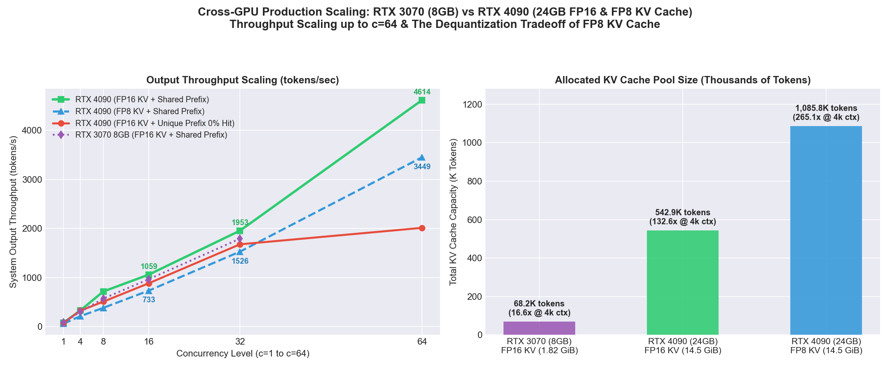
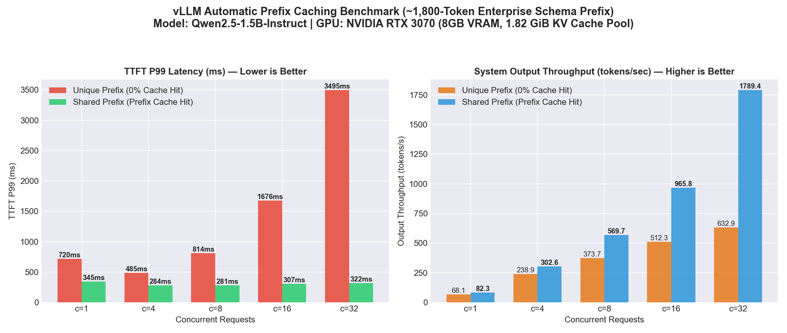
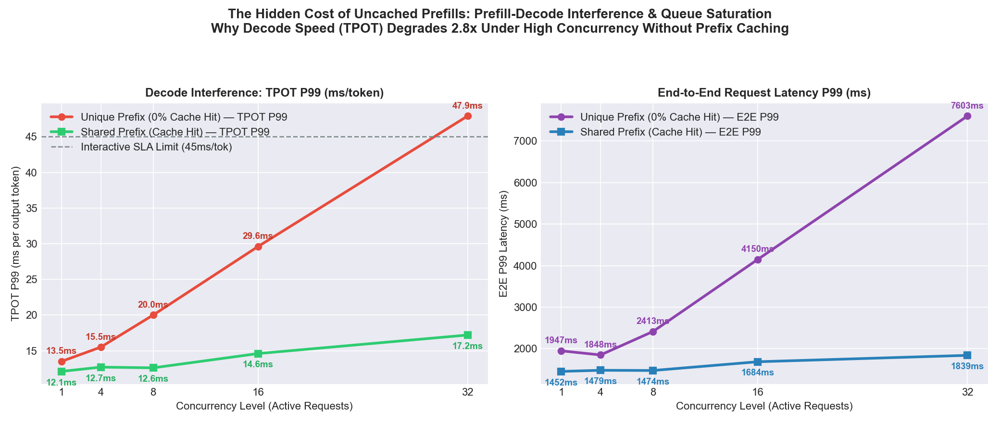

# Production vLLM Stress-Testing & Cost Engineering (RTX 3070 8GB vs RTX 4090 24GB FP16/FP8)

An empirical benchmark and systems analysis of **vLLM Automatic Prefix Caching (APC)**, **Ada Lovelace FP8 KV Cache (`--kv-cache-dtype fp8`)**, and **Prefill-Decode Interference** under concurrent enterprise RAG / Text-to-SQL workloads (~1,800-token shared system schema).

---

## 1. Executive Summary (3 Counter-Intuitive Production Findings)

1. **Missing the Prefix Cache Doesn't Just Hurt TTFT—It Degrades Decode Speed (TPOT) by up to 2.8x**:
   - On `RTX 3070 (8GB)` at `c=32`, 0% prefix cache hit caused **TTFT P99 to explode 10.8x (`321.9 ms` → `3,495.0 ms`)** and **TPOT P99 to degrade 2.8x (`17.2 ms` → `47.9 ms/tok`, breaching a 45ms SLA)** due to **Prefill-Decode Interference** (heavy uncached Prefill GEMMs stealing GPU cycles from active Decode streams).
   - On `RTX 4090 (24GB)` at `c=64`, Prefix Caching cut **TTFT P99 by 11.8x (`1,778.0 ms` → `150.7 ms`)**, cut **TPOT P99 by 2.2x (`28.9 ms` → `13.1 ms`)**, and boosted output throughput by **2.29x (`2,011.1 tok/s` → `4,613.9 tok/s`)**.
2. **The FP8 KV Cache Tradeoff (`--kv-cache-dtype fp8`) — 2.0x Capacity vs ~25% Dequantization Overhead**:
   - Enabling `--kv-cache-dtype fp8` on `RTX 4090` doubled the allocated KV cache pool from **`542,912 tokens` (`132.55x` @ 4k ctx)** to **`1,085,824 tokens` (`265.09x` @ 4k ctx)** in the exact same `14.5 GiB` VRAM envelope.
   - **However**, when the workload was *not* VRAM-capacity-bound (`c=64`), `FP16 KV Cache` achieved **33.8% higher throughput (`4,613.9 tok/s` vs `3,449.1 tok/s`)** and lower TPOT (`13.1 ms` vs `19.4 ms`) than `FP8 KV Cache` because of on-the-fly FP8 scale/dequantization overhead in the attention kernel.
   - **FDE Rule of Thumb**: Do not blindly enable `--kv-cache-dtype fp8` everywhere. Enable it only when `kv_cache_usage_pct > 85%`, when serving long-context workloads (`32k+`), or when fitting larger models (`14B/32B`) where avoiding sequence preemption outweighs the ~25% kernel overhead.
3. **Unit Economics (`$/1M Output Tokens` at Saturation)**:
   - At `c=64` with Prefix Caching (`4,613.94 output tok/s` = `16.61M output tokens/hour`), a single cloud `RTX 4090` (`~$0.39/hr` on RunPod Spot / `~$0.59/hr` On-Demand) delivers **`$0.023 – $0.035 per 1M output tokens`** while maintaining a `150.7 ms` TTFT P99 and `13.1 ms` TPOT P99.

---

## 2. Hardware & KV Cache Allocation Telemetry

| GPU Hardware | Util Flag | Allocated KV Cache Pool | Total KV Tokens | Max Concurrency (@ 4,096 ctx) | Peak Output Throughput |
|---|---:|---:|---:|---:|---:|
| **NVIDIA RTX 3070 (8GB)** | `0.65` | `1.82 GiB` (FP16) | `68,176 tokens` | `16.64x` | `1,789.4 tok/s` (`@ c=32`) |
| **NVIDIA RTX 4090 (24GB)** | `0.80` | `14.50 GiB` (FP16) | `542,912 tokens` | `132.55x` | **`4,613.9 tok/s`** (`@ c=64`) |
| **NVIDIA RTX 4090 (24GB)** | `0.80` | `14.50 GiB` (**FP8**) | **`1,085,824 tokens`** | **`265.09x`** | `3,449.1 tok/s` (`@ c=64`) |

---

## 3. Full Experimental Dataset

### 3.1 NVIDIA RTX 4090 (24GB) — `unique_prefix` (0% Cache Hit Baseline)

| Concurrency | Mode | Throughput (tok/s) | TTFT P50 (ms) | TTFT P99 (ms) | TPOT P50 (ms) | TPOT P99 (ms) | E2E P99 (ms) |
|---:|---:|---:|---:|---:|---:|---:|---:|
| 1 | unique_prefix | **75.63** | 34.4 | **411.1** | 12.7 | 15.1 | 1538.0 |
| 4 | unique_prefix | **324.44** | 69.8 | **110.4** | 11.8 | 12.3 | 1224.2 |
| 8 | unique_prefix | **507.80** | 120.1 | **216.0** | 14.6 | 16.6 | 1644.0 |
| 16 | unique_prefix | **883.05** | 163.4 | **435.0** | 16.7 | 18.6 | 2122.9 |
| 32 | unique_prefix | **1675.50** | 178.5 | **854.2** | 17.0 | 17.8 | 2488.8 |
| 64 | unique_prefix | **2011.13** | 199.9 | **1778.0** | 26.5 | 28.9 | 4377.0 |

### 3.2 NVIDIA RTX 4090 (24GB) — `shared_prefix` (FP16 KV Cache + Prefix Cache Hit)

| Concurrency | Mode | Throughput (tok/s) | TTFT P50 (ms) | TTFT P99 (ms) | TPOT P50 (ms) | TPOT P99 (ms) | E2E P99 (ms) |
|---:|---:|---:|---:|---:|---:|---:|---:|
| 1 | shared_prefix | **78.10** | 26.4 | **41.2** | 12.0 | 15.0 | 1466.3 |
| 4 | shared_prefix | **331.18** | 54.6 | **61.5** | 11.1 | 14.2 | 1397.2 |
| 8 | shared_prefix | **714.62** | 43.2 | **45.6** | 10.9 | 11.0 | 1082.0 |
| 16 | shared_prefix | **1058.97** | 54.6 | **73.5** | 14.6 | 14.8 | 1461.5 |
| 32 | shared_prefix | **1952.92** | 65.4 | **76.5** | 15.9 | 16.0 | 1592.1 |
| 64 | shared_prefix | **4613.94** | 85.4 | **150.7** | 12.9 | 13.1 | 1380.1 |

### 3.3 NVIDIA RTX 4090 (24GB) — `shared_prefix` with `--kv-cache-dtype fp8` (1.08M KV Tokens)

| Concurrency | Mode | Throughput (tok/s) | TTFT P50 (ms) | TTFT P99 (ms) | TPOT P50 (ms) | TPOT P99 (ms) | E2E P99 (ms) |
|---:|---:|---:|---:|---:|---:|---:|---:|
| 1 | shared_prefix (FP8) | **59.80** | 39.5 | **791.1** | 15.5 | 19.4 | 2338.5 |
| 4 | shared_prefix (FP8) | **212.82** | 49.5 | **418.9** | 15.8 | 19.6 | 1920.1 |
| 8 | shared_prefix (FP8) | **381.69** | 64.0 | **70.3** | 18.0 | 18.9 | 1772.8 |
| 16 | shared_prefix (FP8) | **733.03** | 183.1 | **705.4** | 15.7 | 20.9 | 2201.5 |
| 32 | shared_prefix (FP8) | **1525.89** | 73.6 | **85.4** | 20.3 | 21.7 | 2056.3 |
| 64 | shared_prefix (FP8) | **3449.07** | 114.4 | **135.1** | 16.6 | 19.4 | 1729.8 |

### 3.4 NVIDIA RTX 3070 (8GB) — `unique_prefix` vs `shared_prefix` (`c=1..32`)

| Concurrency | Mode | Throughput (tok/s) | TTFT P50 (ms) | TTFT P99 (ms) | TPOT P50 (ms) | TPOT P99 (ms) | E2E P99 (ms) |
|---:|---:|---:|---:|---:|---:|---:|---:|
| 1 | unique_prefix | **68.09** | 133.0 | **719.9** | 12.8 | 13.5 | 1947.2 |
| 16 | unique_prefix | **512.27** | 642.3 | **1676.2** | 24.8 | 29.6 | 4149.7 |
| 32 | unique_prefix | **632.90** | 702.0 | **3495.0** | 43.2 | 47.9 | 7602.8 |
| 1 | shared_prefix | **82.33** | 31.7 | **344.6** | 11.7 | 12.1 | 1451.8 |
| 16 | shared_prefix | **965.80** | 88.0 | **307.4** | 13.9 | 14.6 | 1684.4 |
| 32 | shared_prefix | **1789.43** | 141.8 | **321.9** | 16.0 | 17.2 | 1838.7 |

---

## 4. Production Troubleshooting Notes

1. **Why 90% of Production Prompts Accidentally Break Prefix Caching**:
   vLLM hashes KV cache blocks sequentially in 16-token blocks. Injecting a dynamic timestamp (`Current Time: ...`), `request_id`, or `session_nonce` on Line 1 of the system prompt invalidates 100% of downstream KV blocks. Keep static instructions, tool schemas, and DDLs strictly at token index `0`.
2. **vLLM V1 Engine `flashinfer_sample` JIT Failure on Minimal Driver Containers (`RuntimeError: Could not find nvcc`)**:
   When deploying vLLM on minimal container images or WSL2 nodes that only mount the host NVIDIA driver (`/usr/lib/wsl/lib`) without a full `/usr/local/cuda/bin/nvcc` toolkit, `flashinfer-python` crashes during `determine_available_memory() -> _dummy_sampler_run()` when trying to JIT-compile `top_k_mask_logits` via Ninja.
   - **Fix**: Either pre-install precompiled cubins (`flashinfer-cubin`), or disable FlashInfer JIT sampling (`VLLM_USE_FLASHINFER_SAMPLER=0` / uninstall `flashinfer-python`) to fall back cleanly to native PyTorch/Triton kernels.
