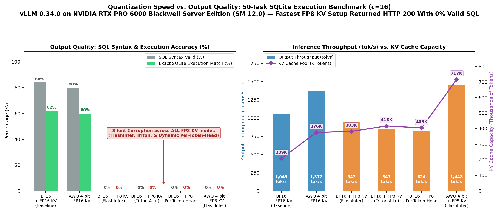
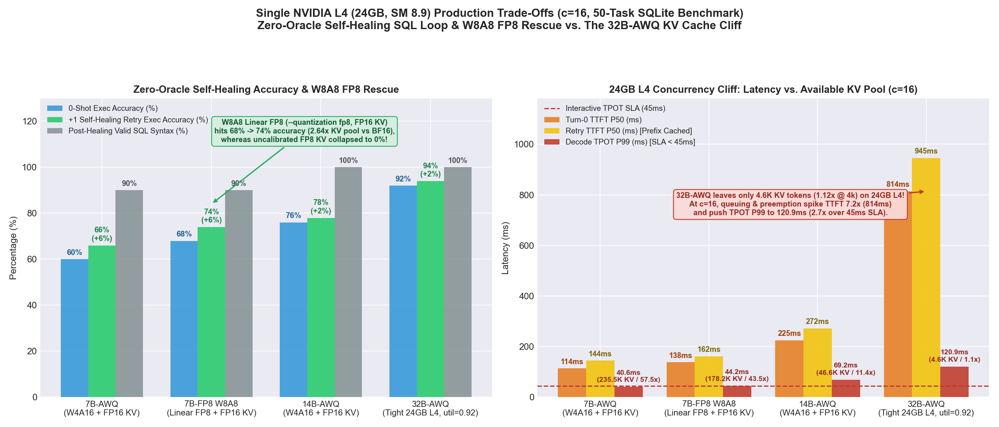
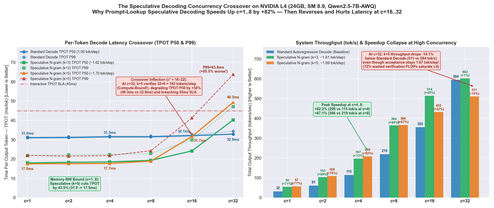

# Production vLLM Stress-Testing & Cost Engineering (RTX 3070 8GB vs RTX 4090 24GB FP16/FP8)

An empirical benchmark and systems analysis of **vLLM Automatic Prefix Caching (APC)**, **Ada Lovelace FP8 KV Cache (`--kv-cache-dtype fp8`)**, and **Prefill-Decode Interference** under concurrent enterprise RAG / Text-to-SQL workloads (~1,800-token shared system schema).

---

## 1. Executive Summary (3 Counter-Intuitive Production Findings)

1. **Missing the Prefix Cache Doesn't Just Hurt TTFT—It Degrades Decode Speed (TPOT) by up to 2.8x**:
   - On `RTX 3070 (8GB)` at `c=32`, 0% prefix cache hit caused **TTFT P99 to explode 10.8x (`321.9 ms` → `3,495.0 ms`)** and **TPOT P99 to degrade 2.8x (`17.2 ms` → `47.9 ms/tok`, breaching a 45ms SLA)** due to **Prefill-Decode Interference** (heavy uncached Prefill GEMMs stealing GPU cycles from active Decode streams).
   - On `RTX 4090 (24GB)` at `c=64`, Prefix Caching cut **TTFT P99 by 11.8x (`1,778.0 ms` → `150.7 ms`)**, cut **TPOT P99 by 2.2x (`28.9 ms` → `13.1 ms`)**, and boosted output throughput by **2.29x (`2,011.1 tok/s` → `4,613.9 tok/s`)**.
2. **The FP8 KV Cache Tradeoff (`--kv-cache-dtype fp8`) — 2.0x Capacity vs ~25% Dequantization Overhead**:
   - Enabling `--kv-cache-dtype fp8` on `RTX 4090` doubled the allocated KV cache pool from **`542,912 tokens` (`132.55x` @ 4k ctx)** to **`1,085,824 tokens` (`265.09x` @ 4k ctx)** in the exact same `14.5 GiB` VRAM envelope.
   - **However**, when the workload was *not* VRAM-capacity-bound (`c=64`), `FP16 KV Cache` achieved **33.8% higher throughput (`4,613.9 tok/s` vs `3,449.1 tok/s`)** and lower TPOT (`13.1 ms` vs `19.4 ms`) than `FP8 KV Cache` because of on-the-fly FP8 scale/dequantization overhead in the attention kernel.
   - **FDE Rule of Thumb**: Do not blindly enable `--kv-cache-dtype fp8` everywhere. Enable it only when `kv_cache_usage_pct > 85%`, when serving long-context workloads (`32k+`), or when fitting larger models (`14B/32B`) where avoiding sequence preemption outweighs the ~25% kernel overhead.
3. **Unit Economics (`$/1M Output Tokens` at Saturation)**:
   - At `c=64` with Prefix Caching (`4,613.94 output tok/s` = `16.61M output tokens/hour`), a single cloud `RTX 4090` (`~$0.39/hr` on RunPod Spot / `~$0.59/hr` On-Demand) delivers **`$0.023 – $0.035 per 1M output tokens`** while maintaining a `150.7 ms` TTFT P99 and `13.1 ms` TPOT P99.


---

## 2. Hardware & KV Cache Allocation Telemetry

| GPU Hardware | Util Flag | Allocated KV Cache Pool | Total KV Tokens | Max Concurrency (@ 4,096 ctx) | Peak Output Throughput |
|---|---:|---:|---:|---:|---:|
| **NVIDIA RTX 3070 (8GB)** | `0.65` | `1.82 GiB` (FP16) | `68,176 tokens` | `16.64x` | `1,789.4 tok/s` (`@ c=32`) |
| **NVIDIA RTX 4090 (24GB)** | `0.80` | `14.50 GiB` (FP16) | `542,912 tokens` | `132.55x` | **`4,613.9 tok/s`** (`@ c=64`) |
| **NVIDIA RTX 4090 (24GB)** | `0.80` | `14.50 GiB` (**FP8**) | **`1,085,824 tokens`** | **`265.09x`** | `3,449.1 tok/s` (`@ c=64`) |

---

## 3. Full Experimental Dataset

### 3.1 NVIDIA RTX 4090 (24GB) — `unique_prefix` (0% Cache Hit Baseline)

| Concurrency | Mode | Throughput (tok/s) | TTFT P50 (ms) | TTFT P99 (ms) | TPOT P50 (ms) | TPOT P99 (ms) | E2E P99 (ms) |
|---:|---:|---:|---:|---:|---:|---:|---:|
| 1 | unique_prefix | **75.63** | 34.4 | **411.1** | 12.7 | 15.1 | 1538.0 |
| 4 | unique_prefix | **324.44** | 69.8 | **110.4** | 11.8 | 12.3 | 1224.2 |
| 8 | unique_prefix | **507.80** | 120.1 | **216.0** | 14.6 | 16.6 | 1644.0 |
| 16 | unique_prefix | **883.05** | 163.4 | **435.0** | 16.7 | 18.6 | 2122.9 |
| 32 | unique_prefix | **1675.50** | 178.5 | **854.2** | 17.0 | 17.8 | 2488.8 |
| 64 | unique_prefix | **2011.13** | 199.9 | **1778.0** | 26.5 | 28.9 | 4377.0 |

### 3.2 NVIDIA RTX 4090 (24GB) — `shared_prefix` (FP16 KV Cache + Prefix Cache Hit)

| Concurrency | Mode | Throughput (tok/s) | TTFT P50 (ms) | TTFT P99 (ms) | TPOT P50 (ms) | TPOT P99 (ms) | E2E P99 (ms) |
|---:|---:|---:|---:|---:|---:|---:|---:|
| 1 | shared_prefix | **78.10** | 26.4 | **41.2** | 12.0 | 15.0 | 1466.3 |
| 4 | shared_prefix | **331.18** | 54.6 | **61.5** | 11.1 | 14.2 | 1397.2 |
| 8 | shared_prefix | **714.62** | 43.2 | **45.6** | 10.9 | 11.0 | 1082.0 |
| 16 | shared_prefix | **1058.97** | 54.6 | **73.5** | 14.6 | 14.8 | 1461.5 |
| 32 | shared_prefix | **1952.92** | 65.4 | **76.5** | 15.9 | 16.0 | 1592.1 |
| 64 | shared_prefix | **4613.94** | 85.4 | **150.7** | 12.9 | 13.1 | 1380.1 |

### 3.3 NVIDIA RTX 4090 (24GB) — `shared_prefix` with `--kv-cache-dtype fp8` (1.08M KV Tokens)

| Concurrency | Mode | Throughput (tok/s) | TTFT P50 (ms) | TTFT P99 (ms) | TPOT P50 (ms) | TPOT P99 (ms) | E2E P99 (ms) |
|---:|---:|---:|---:|---:|---:|---:|---:|
| 1 | shared_prefix (FP8) | **59.80** | 39.5 | **791.1** | 15.5 | 19.4 | 2338.5 |
| 4 | shared_prefix (FP8) | **212.82** | 49.5 | **418.9** | 15.8 | 19.6 | 1920.1 |
| 8 | shared_prefix (FP8) | **381.69** | 64.0 | **70.3** | 18.0 | 18.9 | 1772.8 |
| 16 | shared_prefix (FP8) | **733.03** | 183.1 | **705.4** | 15.7 | 20.9 | 2201.5 |
| 32 | shared_prefix (FP8) | **1525.89** | 73.6 | **85.4** | 20.3 | 21.7 | 2056.3 |
| 64 | shared_prefix (FP8) | **3449.07** | 114.4 | **135.1** | 16.6 | 19.4 | 1729.8 |

### 3.4 NVIDIA RTX 3070 (8GB) — `unique_prefix` vs `shared_prefix` (`c=1..32`)

| Concurrency | Mode | Throughput (tok/s) | TTFT P50 (ms) | TTFT P99 (ms) | TPOT P50 (ms) | TPOT P99 (ms) | E2E P99 (ms) |
|---:|---:|---:|---:|---:|---:|---:|---:|
| 1 | unique_prefix | **68.09** | 133.0 | **719.9** | 12.8 | 13.5 | 1947.2 |
| 16 | unique_prefix | **512.27** | 642.3 | **1676.2** | 24.8 | 29.6 | 4149.7 |
| 32 | unique_prefix | **632.90** | 702.0 | **3495.0** | 43.2 | 47.9 | 7602.8 |
| 1 | shared_prefix | **82.33** | 31.7 | **344.6** | 11.7 | 12.1 | 1451.8 |
| 16 | shared_prefix | **965.80** | 88.0 | **307.4** | 13.9 | 14.6 | 1684.4 |
| 32 | shared_prefix | **1789.43** | 141.8 | **321.9** | 16.0 | 17.2 | 1838.7 |

---

## 4. Production Troubleshooting Notes

1. **Why 90% of Production Prompts Accidentally Break Prefix Caching**:
   vLLM hashes KV cache blocks sequentially in 16-token blocks. Injecting a dynamic timestamp (`Current Time: ...`), `request_id`, or `session_nonce` on Line 1 of the system prompt invalidates 100% of downstream KV blocks. Keep static instructions, tool schemas, and DDLs strictly at token index `0`.
2. **vLLM V1 Engine `flashinfer_sample` JIT Failure on Minimal Driver Containers (`RuntimeError: Could not find nvcc`)**:
   When deploying vLLM on minimal container images or WSL2 nodes that only mount the host NVIDIA driver (`/usr/lib/wsl/lib`) without a full `/usr/local/cuda/bin/nvcc` toolkit, `flashinfer-python` crashes during `determine_available_memory() -> _dummy_sampler_run()` when trying to JIT-compile `top_k_mask_logits` via Ninja.
   - **Fix**: Either pre-install precompiled cubins (`flashinfer-cubin`), or disable FlashInfer JIT sampling (`VLLM_USE_FLASHINFER_SAMPLER=0` / uninstall `flashinfer-python`) to fall back cleanly to native PyTorch/Triton kernels.

---

## 5. Part 2: Quantization Speed vs. SQLite Execution Quality (NVIDIA L4 vs. Blackwell SM 12.0)

Following feedback on Part 1 asking whether `AWQ + FP8 KV Cache` hurts output quality (not just throughput) on an NVIDIA L4, I built a deterministic 50-task Text-to-SQL benchmark ([sql_accuracy_eval.py](sql_accuracy_eval.py)) backed by a seeded in-memory SQLite 3 database (`seed=42`, 4 tables matching the cloud telemetry schema, spanning filtering/`NULL`s, multi-table `JOIN`/`HAVING`, `CASE WHEN` ratios, and Window/CTE queries).

Evaluated across **two GPU architectures** running `vLLM 0.34.0` (`c=16`):
- **NVIDIA L4 (24GB, Ada Lovelace SM 8.9)** — `--gpu-memory-utilization 0.85` (raw JSON: [results_sql_accuracy_l4.json](results_sql_accuracy_l4.json))
- **NVIDIA RTX PRO 6000 Blackwell Server Edition (SM 12.0)** — `--gpu-memory-utilization 0.29` (raw JSON: [results_sql_accuracy_ablation.json](results_sql_accuracy_ablation.json))



### 5.1 Side-by-Side Comparison: NVIDIA L4 (SM 8.9) vs. Blackwell (SM 12.0)

| Setup | GPU | KV Pool (Tokens) | Throughput (tok/s) | TTFT P99 (ms) | TPOT P99 (ms) | SQL Syntax Valid | Exact SQLite Exec Match |
|---|---|---:|---:|---:|---:|---:|---:|
| **BF16 + FP16 KV (Baseline)** | **L4 (SM 8.9)** | `67,584` (`16.5x @ 4k`) | `205.76` | `565.6` | `65.3` | **84.0%** | **62.0%** |
| **AWQ 4-bit + FP16 KV** | **L4 (SM 8.9)** | `235,520` *(3.48x)* | **`325.12`** *(+58.0%)* | `631.3` | **`40.1`** | **80.0%** | **60.0%** *(-2.0%)* |
| **BF16 + FP8 KV** | **L4 (SM 8.9)** | `120,832` | `177.80` | `536.7` | `65.3` | **0.0%** | **0.0%** |
| **AWQ 4-bit + FP8 KV** | **L4 (SM 8.9)** | `454,656` *(6.73x)* | **`350.33`** *(fastest)* | `606.2` | `37.7` | **0.0%** | **0.0%** |
| **BF16 + FP16 KV (Baseline)** | **Blackwell (SM 12.0)** | `208,896` | `1,048.98` | `101.9` | `13.2` | **84.0%** | **62.0%** |
| **AWQ 4-bit + FP16 KV** | **Blackwell (SM 12.0)** | `375,808` *(1.80x)* | **`1,372.15`** *(+30.8%)* | `100.7` | **`9.4`** | **80.0%** | **60.0%** *(-2.0%)* |
| **BF16 + FP8 KV** | **Blackwell (SM 12.0)** | `382,976` | `942.38` | `104.7` | `13.0` | **0.0%** | **0.0%** |
| **AWQ 4-bit + FP8 KV** | **Blackwell (SM 12.0)** | `716,800` | **`1,448.18`** *(fastest)* | `104.5` | `9.3` | **0.0%** | **0.0%** |

### 5.2 Blackwell Backend & Scaling Diagnostics (`vLLM 0.34.0`)

To verify whether the `0.0%` FP8 KV failure was tied to a specific attention kernel, Prefix Caching, or static `scale=1.0` range limits, I tested additional flags on Blackwell:

| Diagnostic Config | KV Pool (Tokens) | Throughput (tok/s) | SQL Syntax Valid | Notes |
|---|---:|---:|---:|---|
| **BF16 + FP8 KV (`TRITON_ATTN`)** | `417,792` | `847.44` | **0.0%** | Identical syntax corruption |
| **AWQ 4-bit + FP8 KV (`TRITON_ATTN`)** | `751,616` | `1,101.91` | **0.0%** | Identical syntax corruption |
| **BF16 + FP8 KV (No PrefixCache)** | `382,976` | `823.87` | **0.0%** | Rules out prefix cache block reuse |
| **BF16 + `fp8_per_token_head`** | `405,120` | `823.93` | **0.0%** | Even dynamic per-token-head scaling returned 0% |
| **BF16 + FP8 KV (`FLASH_ATTN`)** | — | *Failed to start* | — | `Requires FA3 (SM90) or FA4 (SM90/SM100)` |
| **BF16 + `fp8_e5m2` KV** | — | *Failed to start* | — | `Triton Error [CUDA]: illegal memory access` / startup failure |

### Key Takeaways from Part 2

1. **AWQ 4-bit + FP16 KV Is a Huge Win on Memory-Bandwidth-Bound GPUs (Especially L4)**:
   - Accuracy reproduced identically to the tenth of a percent on **both** GPUs: **`84% → 80%` syntax**, **`62% → 60%` exact execution match (-2.0%)**.
   - On **NVIDIA L4**, switching from BF16 to AWQ 4-bit boosted throughput by **+58.0% (`205.8 → 325.1 tok/s`)**, expanded KV capacity **3.48x (`67.6K → 235.5K` tokens)**, and pulled **TPOT P99 from `65.3 ms` down to `40.1 ms`**—bringing it inside a `<45 ms` interactive SLA.
   - Typical AWQ regressions appeared on schema joins and complex aggregations (`case_ratio`: `50% → 40%`, `window_cte`: `40% → 33.3%`), while `filter_null` stayed at `100%`.
2. **Why Throughput-Only Benchmarks Are Dangerous — Uncalibrated FP8 KV Cache on `Qwen2.5-7B`**:
   - Checking on **L4 (SM 8.9)** proved this was **not** a Blackwell-only issue: uncalibrated `--kv-cache-dtype fp8` on `Qwen2.5-7B-Instruct` caused **0.0% valid SQL on BOTH L4 and Blackwell** (emitting garbled SQL like `SELECT org_name, , credit_balance_usd FROM schema WHERE tier = ' '-enterprise` while returning HTTP 200 at the highest throughput in the sweep: `350.3 tok/s` on L4, `1,448.2 tok/s` on Blackwell).
   - Unlike model families with bounded K/V activations (which only drop a few points with uncalibrated FP8 KV), `Qwen2.5-7B-Instruct` requires **properly calibrated KV scaling factors** before flipping `--kv-cache-dtype fp8` in production—and teams must always wire a **deterministic output/execution verifier** into inference CI before trusting `tok/s` benchmarks.

### Reproducing Part 2

```bash
# 1. Validate the seeded SQLite sandbox & all 50 ground-truth SQL queries locally (no GPU required)
python research-vllm-benchmark/sql_accuracy_eval.py --validate-local

# 2. Run the 4-way quantization ablation against live vLLM instances
python research-vllm-benchmark/sql_accuracy_eval.py --run-ablation --concurrency 16 --out results_sql_accuracy_l4.json

# 3. Generate the cross-GPU accuracy vs. throughput chart
python research-vllm-benchmark/plot_accuracy_ablation.py \
  research-vllm-benchmark/results_sql_accuracy_ablation.json \
  research-vllm-benchmark/results_sql_accuracy_l4.json \
  research-vllm-benchmark/charts
```

---

## 6. Part 3: Single L4 (24GB) Production Architecture — W8A8 FP8 Linear Rescue, Zero-Oracle SQLite Self-Healing, and the 32B-AWQ KV Cache Cliff

Part 2 left two critical production questions open for teams running on a single **NVIDIA L4 (24GB, Ada Lovelace SM 8.9)**:
1. **Why did `--kv-cache-dtype fp8` collapse to 0% valid SQL, and how do you safely use L4's native Ada FP8 Tensor Cores?**
2. **To lift SQL execution accuracy from `60%` toward `75%–94%` on a single 24GB L4, should you add a Zero-Oracle SQLite Self-Healing Loop (`7B` + Prefix-Cached compiler retries) or squeeze a larger `14B-AWQ` / `32B-AWQ` model onto the card?**

To answer both, I built [sql_self_healing_eval.py](sql_self_healing_eval.py) with a **Zero-Oracle SQLite Verifier** (`zero_oracle_sqlite_verifier()`, which never reads ground-truth SQL and triggers retries strictly on production-observable signals: `sqlite3.Error`, empty result sets, all-`NULL` aggregates, and static `WHERE`-on-aggregate lint hazards) and benchmarked 4 setups at concurrency `c=16` on `NVIDIA L4 (24GB)` (raw JSON: [results_l4_part3_suite.json](results_l4_part3_suite.json)):



### 6.1 Empirical Results on a Single NVIDIA L4 (24GB, `vLLM 0.34.0`, `c=16`, Prefix Caching Enabled)

| Setup on 1x NVIDIA L4 (24GB) | Free KV Cache Pool (`Max Conc @ 4k`) | 0-Shot Syntax / Exec Acc | +1 Retry Syntax / Exec Acc | +2 Retries Syntax / Exec Acc | Turn-0 TTFT P50 (ms) | Retry TTFT P50 (ms) | Decode TPOT P99 (ms) |
|---|---:|---:|---:|---:|---:|---:|---:|
| **`Qwen2.5-7B-AWQ` (`W4A16 + FP16 KV`)** | **`235,520 tok`** (`12.93 GiB`, `57.5x`) | `80.0%` / `60.0%` | `86.0%` / `66.0%` | **`90.0%` / `66.0%`** | **`113.6`** | **`144.3`** | **`40.6` (PASS)** |
| **`Qwen2.5-7B-FP8` (`--quantization fp8`, `W8A8 Linear + FP16 KV`)** | **`178,176 tok`** (`9.91 GiB`, `43.5x`) | `82.0%` / **`68.0%`** | `88.0%` / **`74.0%`** | **`90.0%` / `74.0%`** | **`138.1`** | **`161.9`** | **`44.2` (PASS)** |
| **`Qwen2.5-14B-AWQ` (`W4A16 + FP16 KV`)** | `46,592 tok` (`8.87 GiB`, `11.4x`) | `92.0%` / `76.0%` | `98.0%` / `78.0%` | **`100.0%` / `78.0%`** | `225.2` | `272.1` | `69.2` (FAIL) |
| **`Qwen2.5-32B-AWQ` (`W4A16 + FP16 KV`, `util=0.92`)** | **`4,608 tok`** (`1.54 GiB`, **`1.12x`**) | `96.0%` / `92.0%` | **`100.0%` / `94.0%`** | **`100.0%` / `94.0%`** | **`813.9`** *(7.2x)* | **`945.3`** | **`120.9` (FAIL)** |

### 6.2 Key Architectural Findings from Part 3

1. **W8A8 Linear FP8 (`--quantization fp8`) vs. Uncalibrated FP8 KV Cache (`--kv-cache-dtype fp8`)**:
   - Engineers often conflate `--quantization fp8` (W8A8 weight + dynamic per-token activation quantization on Ada FP8 Tensor Cores) with `--kv-cache-dtype fp8` (quantizing Attention Key/Value cache tensors).
   - On `Qwen2.5-7B-Instruct`, enabling **`--quantization fp8` while keeping `--kv-cache-dtype auto` (FP16 KV)** works out-of-the-box without calibration datasets: it expands the free KV cache pool **2.64x** vs BF16 (`67,584 → 178,176 tokens`), brings **TPOT P99 down from `65.3 ms` to `44.2 ms`** (inside the `<45 ms` interactive SLA), and achieves **`68.0%` 0-shot execution accuracy** (rising to **`74.0%` execution accuracy / `90.0%` valid SQL** with 1 Zero-Oracle self-healing retry).
   - Why does `--quantization fp8` succeed where `--kv-cache-dtype fp8` collapsed to `0.0%`? Because linear projections use per-channel weight scales and dynamic per-token activation scales, whereas uncalibrated `--kv-cache-dtype fp8` clamps pre-RoPE attention Key channels (which contain extreme outlier spikes in Qwen2.5) without per-head KV scaling factors.
2. **Prefix Caching Makes Multi-Turn Agent Self-Healing Almost Free in Prefill Latency**:
   - Feeding SQLite compiler tracebacks (`no such column`, `misuse of aggregate`, or `0-row` join warnings) back to `7B-FP8 (W8A8)` healed 3 failed queries in 1 retry (`68.0% → 74.0%` execution accuracy, nearly matching `14B-AWQ` 0-shot `76.0%` while maintaining **3.8x more KV cache capacity** and meeting the `45 ms` TPOT SLA).
   - Even though Turn-1 retry prompts are ~2,100 tokens long (`1,800-token schema + question + failed SQL + compiler traceback`), **Retry TTFT P50 is only `144.3 ms` (`7B-AWQ`) / `161.9 ms` (`7B-FP8`)** at `c=16` because the first ~1,950 tokens hit vLLM's Prefix Cache 100%.
3. **The "32B-on-24GB-L4 Trap" (`4,608-Token` KV Cache Cliff)**:
   - Squeezing `Qwen2.5-32B-Instruct-AWQ` (`~18.5 GiB` weights) onto a single 24GB L4 (`--gpu-memory-utilization 0.92`) achieves **`92.0%` (0-shot) / `94.0%` (1-retry) execution accuracy (`100.0%` valid SQL)**.
   - However, it leaves only **`1.54 GiB` (`4,608 tokens`, `1.12x @ 4k`)** for the KV cache pool. At concurrency `c=16`, sequences cannot coexist in VRAM—forcing vLLM to queue and preempt requests, which spikes **TTFT P50 7.2x (`113.6 ms → 813.9 ms`, P99 `2,735.5 ms`)** and pushes **TPOT P99 to `120.9 ms`** (`2.7x` above the `45 ms` SLA).
   - **Rule of thumb for L4 sizing**: Use `32B-AWQ` on a single 24GB L4 only for low-concurrency batch/internal BI (`c=1..2`); for interactive concurrency (`c=16+`), run `7B-FP8 (W8A8)` or `7B-AWQ` with a Prefix-Cached compiler feedback loop, or move `32B-AWQ` to a 48GB+ GPU.

### Reproducing Part 3

```bash
# 1. Validate the Zero-Oracle SQLite Verifier locally (confirms 0/50 false-positive triggers on ground truth)
python research-vllm-benchmark/sql_self_healing_eval.py --validate-local

# 2. Run the 4-model Self-Healing & W8A8 FP8 suite on an NVIDIA L4 (24GB)
python research-vllm-benchmark/sql_self_healing_eval.py --run-suite --concurrency 16 --out research-vllm-benchmark/results_l4_part3_suite.json

# 3. Generate the Part 3 dual-panel comparison chart
python research-vllm-benchmark/plot_self_healing_part3.py
```

---

## 7. Part 4: The Speculative Decoding Concurrency Crossover on NVIDIA L4 (`c = 1..32`)

A common misconception in production LLM serving is that **Speculative Decoding** is a free "2x speedup switch" at any traffic load. In reality, speculative verification trades **idle Tensor Core FLOPs** for **fewer memory-bandwidth reads**—which means it undergoes a sharp **Roofline Inversion** as concurrency increases.

To measure the exact crossover concurrency (`c*`) on an **NVIDIA L4 (24GB, Ada Lovelace SM 8.9)**, I built [spec_decoding_crossover_eval.py](spec_decoding_crossover_eval.py) using `stream_options={"include_usage": True}` (ensuring exact tokenizer-verified `completion_tokens` and `TPOT` across multi-token speculative verification bursts) and swept `c = 1, 2, 4, 8, 16, 32` on `Qwen/Qwen2.5-7B-Instruct-AWQ` across three configurations (raw JSON: [results_l4_spec_decoding.json](results_l4_spec_decoding.json)):
1. **Standard Autoregressive Decode (Baseline)** (`1.006 tokens/step`)
2. **Speculative Decoding (`N-gram Prompt Lookup`, `k=3`, `prompt_lookup_max=4`)** (`~1.61 tokens/step`)
3. **Speculative Decoding (`N-gram Prompt Lookup`, `k=5`, `prompt_lookup_max=4`)** (`~1.69 tokens/step`)



### 7.1 Concurrency Sweep Table (`NVIDIA L4 24GB`, `vLLM 0.34.0`, `Qwen2.5-7B-Instruct-AWQ`)

| Concurrency | Mode | Accepted Tok / Step | Throughput (tok/s) | Speedup vs. Std | TPOT P50 (ms/tok) | TPOT P99 (ms/tok) | E2E Latency P50 (ms) | SQLite Exec Match |
|---:|---|---:|---:|---:|---:|---:|---:|---:|
| **`c = 1`** | **Standard Autoregressive** | `1.006` | `31.98` | `1.00x` | `31.0` | `31.4` | `5,288.8` | `43.8%` |
| **`c = 1`** | **Speculative N-gram (`k=3`)** | `1.622` | `54.62` | **`+70.8%`** | **`18.0`** *(-41.9%)* | `21.8` | `3,228.2` | `43.8%` |
| **`c = 1`** | **Speculative N-gram (`k=5`)** | `1.700` | **`56.73`** | **`+77.4%`** | **`17.5`** *(-43.5%)* | **`21.9`** | **`3,048.4`** *(-42.4%)* | `43.8%` |
| **`c = 2`** | **Standard Autoregressive** | `1.005` | `61.04` | `1.00x` | `31.1` | `31.6` | `5,305.2` | `43.8%` |
| **`c = 2`** | **Speculative N-gram (`k=3`)** | `1.637` | `102.97` | **`+68.7%`** | `18.3` | `22.2` | `3,277.4` | `43.8%` |
| **`c = 2`** | **Speculative N-gram (`k=5`)** | `1.700` | **`108.94`** | **`+78.5%`** | **`17.6`** | **`21.5`** | **`3,063.6`** | `43.8%` |
| **`c = 4`** | **Standard Autoregressive** | `1.006` | `114.51` | `1.00x` | `31.5` | `31.9` | `5,383.6` | `43.8%` |
| **`c = 4`** | **Speculative N-gram (`k=3`)** | `1.637` | `196.81` | **`+71.9%`** | `18.5` | `22.3` | `3,297.2` | `43.8%` |
| **`c = 4`** | **Speculative N-gram (`k=5`)** | `1.722` | **`208.60`** | **`+82.2%` (Peak)** | **`17.7`** | **`21.8`** | **`3,162.4`** | `43.8%` |
| **`c = 8`** | **Standard Autoregressive** | `1.006` | `219.24` | `1.00x` | `31.5` | `31.9` | `5,236.0` | `50.0%` |
| **`c = 8`** | **Speculative N-gram (`k=3`)** | `1.604` | `364.27` | **`+66.2%`** | `19.3` | **`22.9`** | `3,306.4` | `50.0%` |
| **`c = 8`** | **Speculative N-gram (`k=5`)** | `1.671` | **`366.40`** | **`+67.1%`** | **`18.9`** | `24.3` | **`3,256.1`** | `50.0%` |
| **`c = 16`** | **Standard Autoregressive** | `1.006` | `355.20` | `1.00x` | `32.1` | `32.6` | `5,417.5` | `50.0%` |
| **`c = 16`** | **Speculative N-gram (`k=3`)** | `1.600` | **`513.94`** | **`+44.7%`** | **`24.2`** | **`29.9`** | **`4,258.1`** | `50.0%` |
| **`c = 16`** | **Speculative N-gram (`k=5`)** | `1.671` | `431.79` | `+21.6%` | `31.7` *(crossover)* | **`41.3` (+26.7% worse)** | `5,147.7` | `50.0%` |
| **`c = 32`** | **Standard Autoregressive** | `1.006` | **`594.42`** | **`1.00x`** | **`32.9`** | **`34.4` (PASS)** | **`5,642.9`** | `50.0%` |
| **`c = 32`** | **Speculative N-gram (`k=3`)** | `1.597` | `601.75` | `+1.2%` | **`40.2` (+22.2% worse)** | **`47.2` (SLA FAIL)** | `6,930.5` *(+22.8%)* | `50.0%` |
| **`c = 32`** | **Speculative N-gram (`k=5`)** | `1.671` | **`510.54`** | **`-14.1%` (Slower)** | **`49.3` (+49.8% worse)** | **`63.8` (+85.5% worse)** | **`8,380.4` (+48.5%)** | `50.0%` |

### 7.2 Key Takeaways from Part 4

1. **Why Speculative Decoding Reverses Above `c* ≈ 16–22` Even When Acceptance Rate Never Drops**:
   - Look closely at the `Accepted Tok / Step` column for `k=5`: it stays rock-solid at **`1.671 tokens/step`** across `c=8`, `c=16`, and `c=32`. The n-gram acceptance rate did **not** degrade at high concurrency!
   - Why, then, did `k=5` swing from a **`+82.2%` speedup at `c=4`** (`TPOT P50 = 17.7 ms`) to a **`-14.1%` throughput loss and `+85.5%` worse P99 TPOT (`63.8 ms vs 34.4 ms`) at `c=32`**?
   - **Roofline Arithmetic Intensity Transition**: At `c=1..4`, standard decoding verifies only `1..4` tokens per forward pass and is 100% **Memory-Bandwidth-Bound** on L4's `300 GB/s` GDDR6 bus; verifying `k+1 = 6` tokens per sequence (`4 × 6 = 24` tokens total) uses otherwise-idle Tensor Core FLOPs for free. At `c=32`, however, `k=5` forces every forward pass to evaluate **`32 × 6 = 192` tokens per step**—pushing the L4 deep into the **Compute-Bound** regime where **72% of the verification FLOPs (`4.33` rejected tokens out of `6` verified) directly stall all 32 active requests**!
2. **Smaller Speculative Depth (`k=3`) Extends the Crossover Horizon vs. `k=5`**:
   - At `c=16`, `k=5` (`16 × 6 = 96` tokens/step) has already hit the compute ceiling (`TPOT P50 = 31.7 ms`, `P99 = 41.3 ms`), whereas `k=3` (`16 × 4 = 64` tokens/step) still delivers **`+44.7%` higher throughput (`513.9 vs 355.2 tok/s`)** and **`24.2 ms` TPOT P50**.
   - By `c=32` (`32 × 4 = 128` tokens/step), even `k=3` crosses over: its throughput gain vanishes (`+1.2%`) while its `TPOT P50` (`40.2 ms` vs `32.9 ms`) and `TPOT P99` (`47.2 ms` vs `34.4 ms`) fall behind standard decoding.
3. **Mathematically Lossless Verification Confirmed**:
   - At every concurrency level (`c=1..32`), SQLite execution accuracy was bit-for-bit identical across `Standard`, `k=3`, and `k=5` (`43.8%` on the 16-task subset, `50.0%` on the 32-task subset with the added `<audit>` block).

### Reproducing Part 4

```bash
# 1. Validate the 32-task balanced subset & SpeculativeConfig JSON builder locally
python research-vllm-benchmark/spec_decoding_crossover_eval.py --validate-local

# 2. Run the 18-point concurrency crossover sweep (c=1..32 x 3 decoding modes) on NVIDIA L4
python research-vllm-benchmark/spec_decoding_crossover_eval.py --run-sweep --out research-vllm-benchmark/results_l4_spec_decoding.json

# 3. Generate the Part 4 dual-panel crossover chart
python research-vllm-benchmark/plot_spec_decoding_part4.py
```
